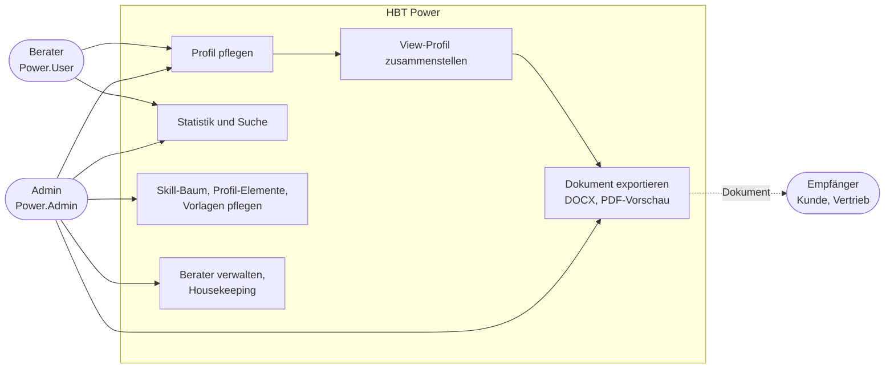

# 1. Einführung und Ziele

## 1.1 Aufgabenstellung

HBT Power ist die Anwendung, in der die Beraterinnen und Berater der HBT ihr Profil pflegen. Daraus entstehen die Profile, die HBT an Kunden und Interessenten weitergibt.

- **Profil pflegen:** Werdegang, Ausbildung, Weiterbildungen, Qualifikationen, Sprachen, Branchen, Schwerpunkte, Projekte (Kunde, Vermittler, Rollen, Skills, Zeitraum) und Skills mit Bewertung und Versionen. Eine Profilprüfung zeigt, was fehlt oder veraltet ist (#139).
- **Exportieren:** Aus einem Profil entsteht ein *View-Profil*, eine bearbeitbare Momentaufnahme für einen Export. Darin wird ausgewählt, sortiert und gruppiert, und optional werden Skills übersetzt (#174). Daraus erzeugt der Report Service ein Word-Dokument in einer HBT-Vorlage oder eine PDF-Vorschau.
- **Pflegen (Admin):**
  - Berater anlegen, ändern und löschen.
  - Den Skill-Baum pflegen: Kategorien, Skills, Aliase, Versionen, Übersetzungen.
  - Profil-Elemente umbenennen, zusammenführen und löschen.
  - Vorlagen hochladen.
  - Datenleichen bereinigen (*Housekeeping*).
- **Auswerten:** Statistiken zur Nutzung von Skills und zu ähnlichen Profilen, die Suche nach Beratern mit bestimmten Skills, und wer welchen Skill oder welches Profil-Element benutzt.

Die Bedienoberfläche ist deutsch (`pwr-webclient/src/localization/de-DE.json`). Die Anmeldung läuft über das Microsoft-365-Konto der HBT.

## 1.2 Qualitätsziele

Die fünf wichtigsten Qualitätsziele, abgeleitet aus den Issues. Szenarien dazu stehen in [Kapitel 10](10-qualitaetsanforderungen.md).

| Prio | Qualitätsziel | Was das für HBT Power heißt |
|---:|---|---|
| 1 | **Korrekte, konsistente Daten** | Ein Skill heißt überall gleich (#207, #208), Datumsangaben verschieben sich nicht (#24, #26), Löschen entfernt alles, was dazugehört (#240, #243), Datenleichen werden erkannt (#242). |
| 2 | **Sicherheit und Datenschutz** | Profile sind personenbezogene Daten: Zugriff nur angemeldet und mit Rolle (#67, #178, #218). Wer etwas tut, ist nicht fälschbar (#203, #214). Nicht mehr Daten herausgeben als nötig (#216). |
| 3 | **Bedienbarkeit und Barrierefreiheit** | Einheitliche Formulare, URLs, die den Zustand tragen (#182), Schutz vor ungespeicherten Änderungen (#44), Kontraste nach WCAG AA (#201), mobil nutzbar (#49). |
| 4 | **Wartbarkeit** | Kleine, nachvollziehbare Änderungen mit Issue, CI und Definition of Done (#2, #6). Jeder Stand ist am Commit erkennbar (#77). Der veraltete Stack soll modernisiert werden (#50–#53). |
| 5 | **Qualität der Dokumente** | Export in der Hausschrift (#81, #82), die Vorschau entspricht dem Export (#66), es gibt keine abgeschnittenen Texte (#86). |

## 1.3 Stakeholder

| Rolle | Erwartung an HBT Power |
|---|---|
| **Beraterinnen und Berater** (`Power.User`) | Das eigene Profil schnell und mobil pflegen, Exporte erzeugen, sehen, was am Profil fehlt. Das eigene Profil öffnet sich nach der Anmeldung direkt (#135). |
| **Admins** (`Power.Admin`, z. B. Vertrieb, Ressourcenplanung) | Profile aller Berater sehen und exportieren, Stammdaten (Skill-Baum, Profil-Elemente, Vorlagen) sauber halten, Berater verwalten. |
| **Empfänger der Dokumente** (Kunden, Vermittler, Partner) | Ein gut lesbares Profil im HBT-Layout. Ein Layout ohne HBT-Branding für Partner ist angedacht (#64). |
| **Entwicklung** (auch mit Agenten, [`AGENTS.md`](../../AGENTS.md)) | Klare Regeln, reproduzierbarer Build, lokale Umgebung auf macOS, Linux und Windows (#1). |
| **Betrieb** | Automatisches Deployment ohne Ausfall, nachvollziehbare Stände, Backups. Die Betriebskonfiguration liegt in [`HBTGmbH/pwr-compose-deploy`](https://github.com/HBTGmbH/pwr-compose-deploy). |
| **Datenschutz** | Personenbezogene Daten nur für Berechtigte. Löschen bedeutet vollständig löschen (#240). |
