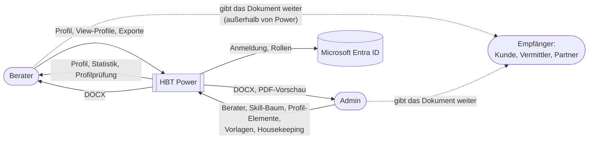
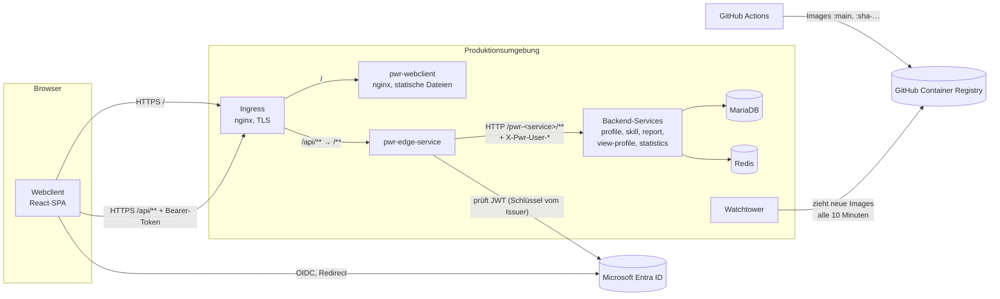

# 3. Kontextabgrenzung

## 3.1 Fachlicher Kontext

| Partner | Eingabe an HBT Power | Ausgabe von HBT Power |
|---|---|---|
| **Berater** | Das eigene Profil, View-Profile und Exportwünsche | Profil, Profilprüfung, Statistik, Word-Dokument, PDF-Vorschau |
| **Admin** | Berater, Skill-Baum, Profil-Elemente, Vorlagen (BIRT-Designs), Entscheidungen zu Datenleichen | Profile und Exporte aller Berater, wer was benutzt, Statistik, Housekeeping-Befunde |
| **Empfänger** | – | Das Dokument; Power selbst sieht er nicht. |
| **Microsoft Entra ID** | Konten, App-Rollen `Power.User` und `Power.Admin`, Claims (`mailnickname` = Kürzel) | Anmeldeanfragen |

Die Kürzel (`initials`) verbinden Konto und Berater: Das Kürzel aus dem Claim `mailnickname` öffnet das eigene Profil (#135). Ein Berater ohne Konto kann von Admins gepflegt werden, ein Konto ohne Berater bekommt einen Hinweis.

## 3.2 Technischer Kontext

| Schnittstelle | Technik | Beschreibung |
|---|---|---|
| Browser → Ingress `/` | HTTPS | Statische Dateien des Webclients, `config.js` mit den Service-URLs, `build_info.json` |
| Browser → Ingress `/api/pwr-<service>/**` | HTTPS, JSON, `Authorization: Bearer` | Alle fachlichen Aufrufe. Der Ingress entfernt `/api`, die Edge entfernt `/pwr-<service>`. |
| Browser ↔ Entra ID | OIDC (MSAL, Redirect-Flow) | Scopes `openid`, `offline_access` und der API-Scope von Power. Die Token werden still erneuert. |
| Edge → Entra ID | HTTPS | Die Signaturschlüssel kommen über den konfigurierten Issuer (`spring.security.oauth2.resourceserver.jwt.issuer-uri`). |
| Edge → Services | HTTP im Container-Netz | Die Routen `/pwr-<service>/**`; die Edge setzt `X-Pwr-User-Login` und `X-Pwr-User-Initials` aus dem Token. |
| Services ↔ Services | HTTP, `RestTemplate` | Direkt, nicht über die Edge ([Kapitel 5](05-bausteinsicht.md#53-abhängigkeiten-zwischen-den-services)). |
| GitHub Actions → GHCR | Docker Registry | Der `publish`-Job jedes Ordners schiebt `:main` und `:sha-<commit>`. |
| Watchtower → GHCR | Docker Registry | Zieht neue `:main`-Images und erzeugt die Container neu. |

Es gibt keine weiteren Fremdsysteme: Weder Mails noch Kalender noch HR-Systeme sind angebunden. Berater legen Admins von Hand an.
