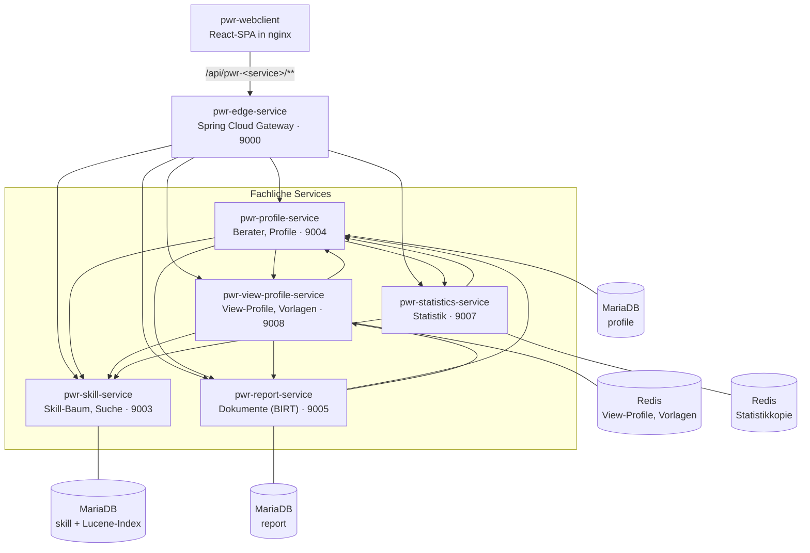
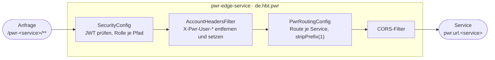
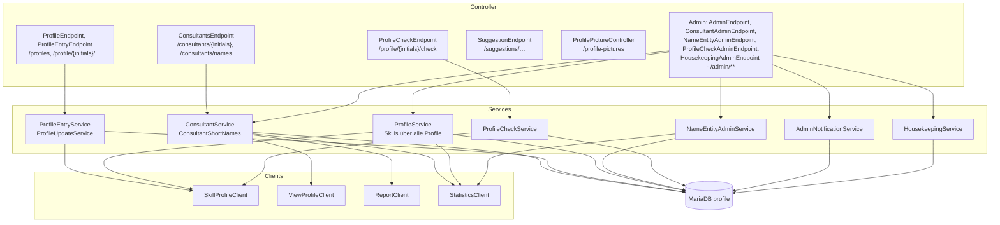
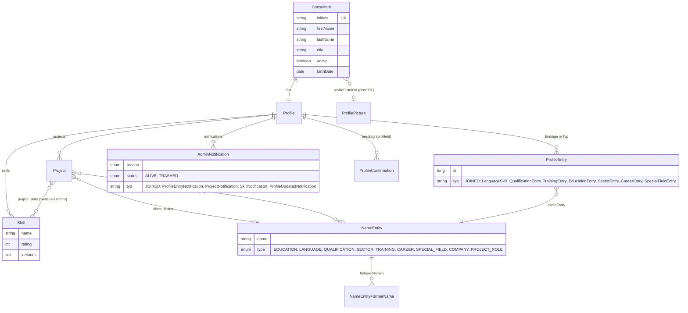
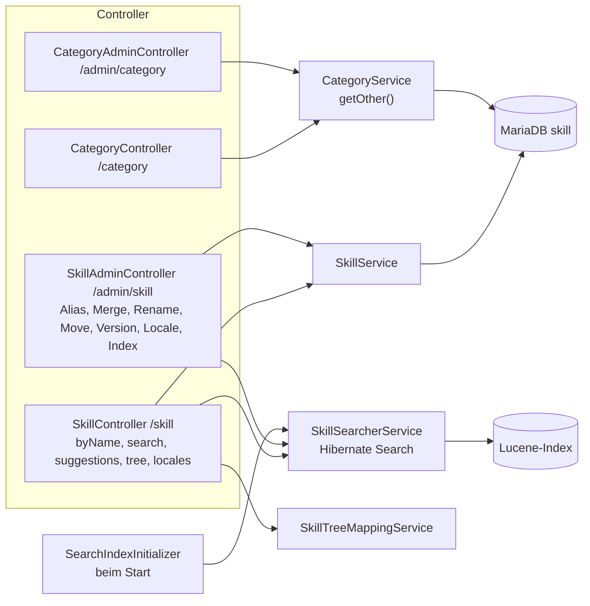
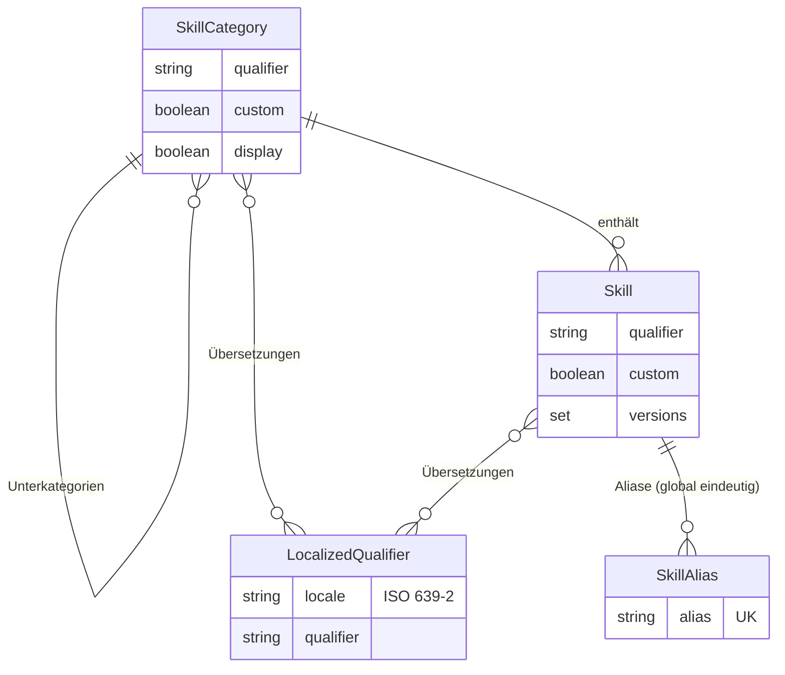
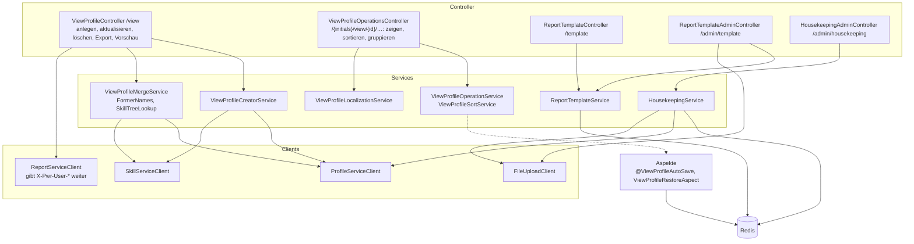
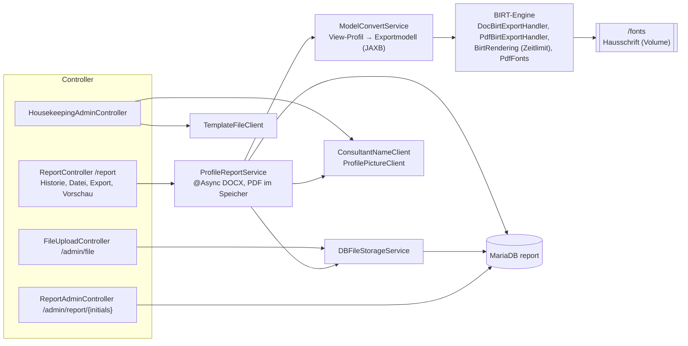
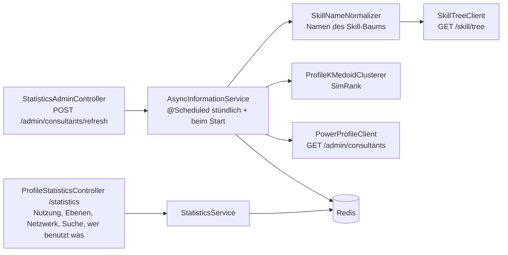
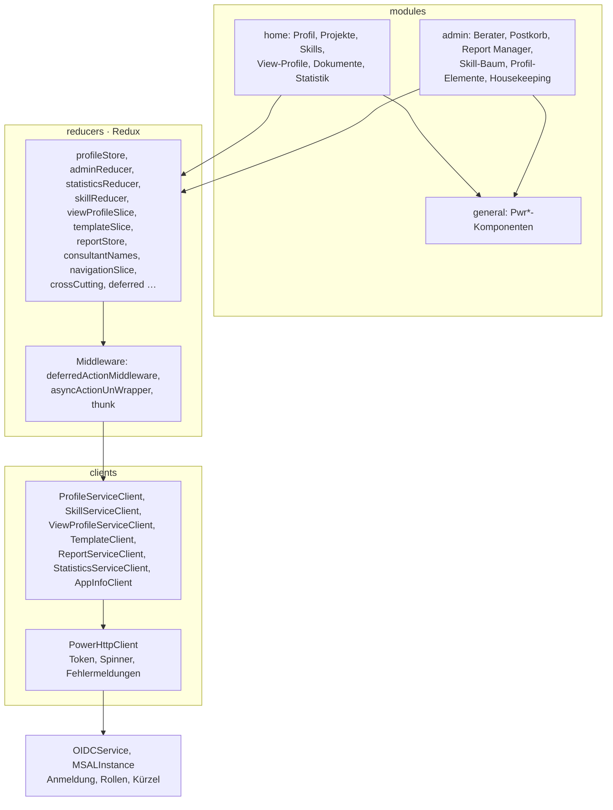

# 5. Bausteinsicht

## 5.1 Ebene 1: Gesamtsystem

| Baustein | Verantwortung | Daten |
|---|---|---|
| **pwr-webclient** | Bedienoberfläche für Berater und Admins | nur im Browser (Redux) |
| **pwr-edge-service** | Einziger Eingang: Token prüfen, Rollen je Pfad, Identitäts-Header setzen, Routing | keine |
| **pwr-profile-service** | Berater, Profile mit Einträgen, Projekten und Skills, Profil-Elemente, Profilbilder, Benachrichtigungen, Profilprüfung; Admin-Operationen über alle Profile | MariaDB `profile` |
| **pwr-skill-service** | Skill-Baum (Kategorien, Skills, Aliase, Versionen, Übersetzungen) und Suche | MariaDB `skill`, Lucene-Index |
| **pwr-view-profile-service** | View-Profile (Momentaufnahmen für einen Export), Vorlagen-Metadaten; stößt Export und Vorschau an | Redis |
| **pwr-report-service** | Rendert Dokumente mit BIRT, speichert die Dokumente (Historie) und die Vorlagen-Dateien | MariaDB `report` |
| **pwr-statistics-service** | Eigene Kopie aller Berater und Profile; Statistik, Suche nach Beratern, wer was benutzt | Redis |

Jeder Ordner ist ein eigenständiges Maven- bzw. npm-Projekt ohne gemeinsamen Code. Modelle, die mehrere Services kennen (z. B. das Profil), hat jeder Service als eigene Klassen.

## 5.2 Ebene 2: Die Bausteine im Einzelnen

Die Services sind nach demselben Muster gebaut: Controller (REST) → Service (Fachlogik) → Repository (Spring Data), dazu `client` für Aufrufe anderer Services. Nur die Edge weicht ab.

### 5.2.1 pwr-edge-service

- `filters/SecurityConfig`:
  - `/pwr-<service>/admin/**` verlangt `Power.Admin`, alles andere `Power.User` oder `Power.Admin`.
  - Die Rollen kommen aus dem Claim `roles`, ohne Präfix.
- `filters/AccountHeadersFilter`:
  - Entfernt `X-Pwr-User-Login` und `X-Pwr-User-Initials`, falls ein Client sie mitschickt.
  - Setzt sie neu aus dem geprüften Token: Login aus `preferred_username`, `upn` oder `email`, Kürzel aus `mailnickname` (klein geschrieben).
- `PwrRoutingConfig` und `PwrEdgeConfig`: Routen `to-profile`, `to-skill`, `to-report`, `to-view-profile` und `to-statistics` mit Ziel aus `pwr.url.*`.
- Eigener Actuator unter `/pwr-edge-service/actuator`, nur `health` und `info`.

### 5.2.2 pwr-profile-service

Wichtige Schnittstellen (nach außen über `/pwr-profile-service`):

| Bereich | Endpunkte |
|---|---|
| Eigenes Profil | `GET /consultants/{initials}`, `GET/PUT/DELETE /profile/{initials}/<typ>/{id}` für `language`, `qualification`, `sector`, `specialfield`, `career`, `training`, `education`, `skill`, `project`; `GET/PUT /profile/{initials}/baseProfile` |
| Für alle Benutzer | `GET /consultants/names` (Kürzel, Kurz- und voller Name, #216), `GET /suggestions/*`, `GET /profile-pictures/{id}` |
| Profilprüfung | `GET /profile/{initials}/check`, `POST …/check/confirmation` (wer bestätigt, aus den Headern) |
| Admin | `/admin/consultants` (auch die Quelle der Statistik), `/admin/notifications`, `/admin/skills/merge|rename`, `DELETE /admin/skills?name=`, `/admin/name-entities/**`, `/admin/profile-checks`, `/admin/housekeeping` |

Datenmodell (vereinfacht):

Besonderheiten (Details in [`AGENTS.md`](../../AGENTS.md)):
- `ProfileEntry` und `AdminNotification` sind mit `JOINED` vererbt. Altdaten enthalten Zeilen in `profile_entry` ohne Zeile eines Eintragstyps (#236), deshalb werden Einträge je Typ geladen.
- Die Skills eines Projekts sind dieselben Zeilen wie die Skills des Profils (`ProfileEntryService.handleProjectSkill`).
- Ein aus einer Collection entferntes Element bleibt als Zeile mit `profile_id` NULL stehen. Projekte löscht `deleteProject` seit #243 wirklich.
- Profil-Elemente (`NameEntity`) sind gemeinsame Einträge aller Profile. Umbenannte und zusammengeführte Elemente behalten ihre früheren Namen (#227, #230).

### 5.2.3 pwr-skill-service

- Ein unbekannter Skill, den ein Berater einträgt, kommt in die Kategorie „Other“ (`POST /skill?qualifier=`). Admins sortieren ihn dort ein.
- Der Index wird bei jedem Start neu aufgebaut (`SearchIndexInitializer`) und lässt sich mit `POST /admin/skill/lucene/index` neu erstellen.
- Der Service ruft keinen anderen Service auf.

### 5.2.4 pwr-view-profile-service

- **`ViewProfile`** (`@RedisHash("viewProfile")`):
  - Kopie der Profileinträge mit Sichtbarkeit und Reihenfolge.
  - Anzeigekategorien mit Skills und Versionen.
  - Besitzer und Name, Sprache der Übersetzung (`localization`).
- **`ReportTemplate`** (`@RedisHash("reportTemplate")`): Name, Beschreibung und `fileId`. Die Datei liegt im Report Service.
- **Speichern und Lesen:** Jede Änderung speichert über den Aspekt `@ViewProfileAutoSave`. Beim Lesen repariert `ViewProfileRestoreAspect` ältere Daten, z. B. Standardwerte neuer Felder (#151).
- ***Aktualisieren*:** Übernimmt Änderungen des Profils in ein View-Profil und behält dessen Einstellungen. Umbenannte Elemente findet es über die früheren Namen und den Skill-Baum (#230).

### 5.2.5 pwr-report-service

- **Ablauf beim Rendern:** Das View-Profil wird ins alte Exportmodell (`Profil`, `Projekt`, `Werdegang` …) übersetzt und als XML-Datei geschrieben. Die BIRT-Vorlage liest diese Datei über ihre XML-Datenquelle.
- **`ReportData`** (Tabelle `report_data`):
  - das fertige Dokument, Status `RUNNING`, `DONE` oder `ERROR`;
  - wer exportiert hat (aus den Headern, #214), welche Vorlage verwendet wurde und die Beschreibung des View-Profils.
- **`DBFile`** (Tabelle `designfiles`): die BIRT-Designs. Auf sie verweist die `fileId` einer Vorlage im View-Profile Service.
- **Schrift:** Die Hausschrift kommt aus `/fonts` (`export.font-directory`); ohne sie nimmt BIRT Noto Sans aus dem Image (`PdfFonts`).

### 5.2.6 pwr-statistics-service

- Die Kopie (`@RedisHash("Consultant")` mit eingebettetem Profil) wird bei jedem Laden ganz ersetzt. Scheitert das Laden, bleibt die alte (#218).
- Alles, was der Service beantwortet, kommt aus dieser Kopie, auch „wer benutzt diesen Skill / dieses Profil-Element“ in der Admin-Oberfläche.

### 5.2.7 pwr-webclient

| Bereich | Pfade (`src/Paths.ts`) |
|---|---|
| Einstieg | `/` (Anmeldung), `/profilauswahl` |
| Profil eines Beraters | `/app/:initials/home`, `…/profile`, `…/profile/projects/:projectId`, `…/profile/skills`, `…/views`, `…/view/:id`, `…/reports`, `…/search`, `…/statistics/*` |
| Admin | `/admin/home/inbox`, `…/trashbox`, `…/consultants`, `…/templates`, `…/statistics/skills`, `…/info/skilltree`, `…/info/names`, `…/info/skills`, `…/housekeeping` |

- **Laufzeitkonfiguration:** `config.js` mit Platzhaltern, die `configure_api.sh` beim Start des nginx-Containers ersetzt.
- **Lokal:** `start:local` leitet über `src/setupProxy.js` direkt auf die Ports der Services und überspringt die Anmeldung.

## 5.3 Abhängigkeiten zwischen den Services

| Aufrufer | Ziel | Endpunkte | Wozu |
|---|---|---|---|
| profile | skill | `POST /skill?qualifier=`, `GET /skill/tree`, `GET /skill/byName`, `/admin/skill/merge|rename`, `DELETE /admin/skill/{id}` | neue Skills nach „Other“, Namen des Baums, Profilprüfung, Skills umbenennen, zusammenführen, löschen |
| profile | view-profile | `GET /view/{initials}`, `DELETE /view/{initials}/{id}` | Berater löschen |
| profile | report | `DELETE /admin/report/{initials}` | Berater löschen |
| profile | statistics | `POST /admin/consultants/refresh` | Kopie nach Massenänderungen neu laden |
| view-profile | profile | `GET /profiles/{initials}`, `GET /consultants/{initials}`, `GET /admin/name-entities/former-names`, `GET /consultants/names` | Momentaufnahme, *Aktualisieren*, Housekeeping |
| view-profile | skill | `GET /skill/byName` | Kategorien, Namen und Übersetzungen des Baums |
| view-profile | report | `POST /report?type=`, `POST /report/preview`, `/admin/file` | Export, Vorschau, Vorlagen-Dateien |
| report | profile | `GET /consultants/{initials}`, `GET /consultants/names`, `GET /profile-pictures/by-initials/{initials}` | Name des Exportierenden, Housekeeping, Profilbild im Dokument |
| report | view-profile | `GET /admin/template/files` | Housekeeping |
| statistics | profile | `GET /admin/consultants` | Kopie aller Berater |
| statistics | skill | `GET /skill/tree` | Namen normalisieren |

Diese Aufrufe gehen direkt im Container-Netz, nicht über die Edge. Deshalb erreichen sie auch die `/admin`-Pfade ohne Token.
