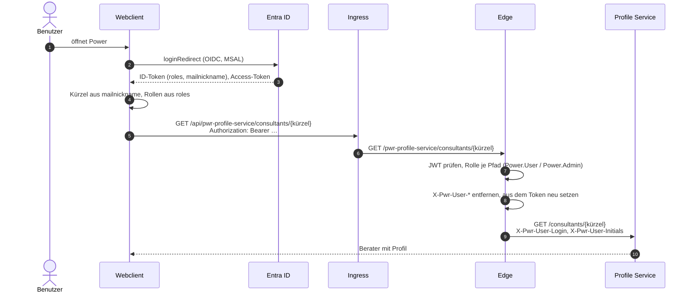
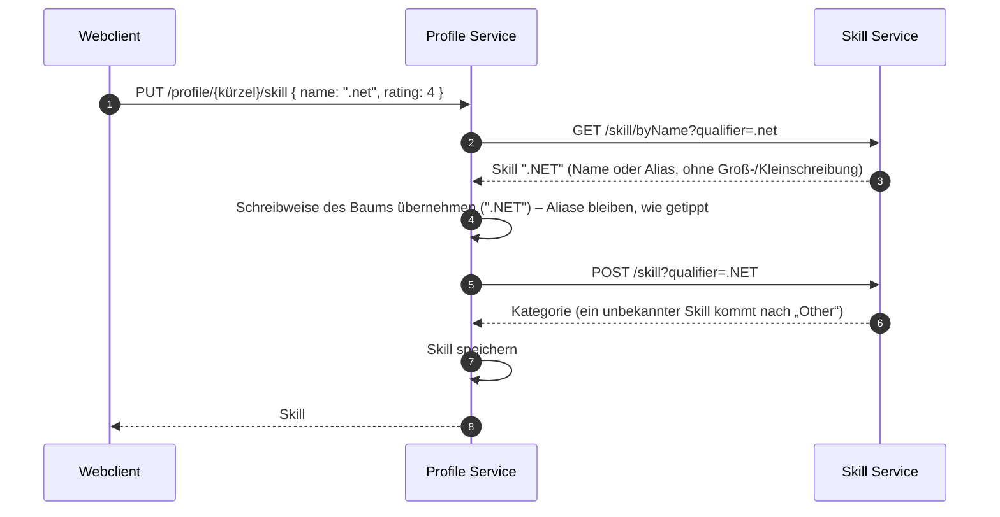
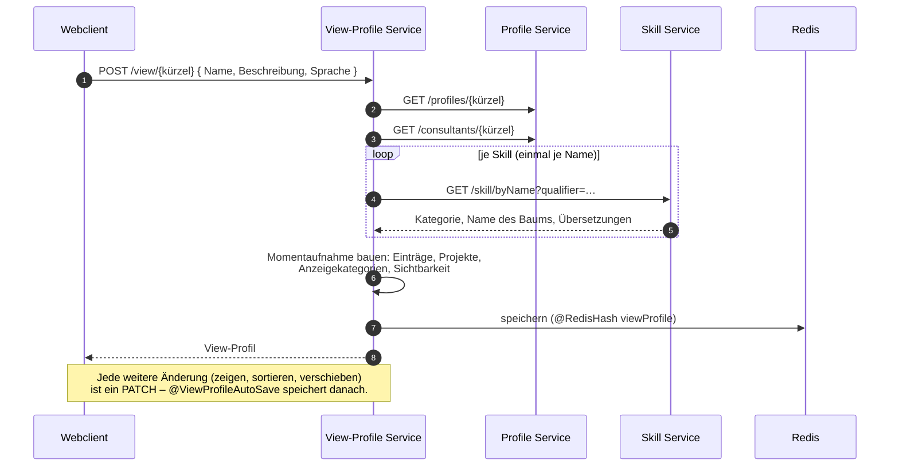
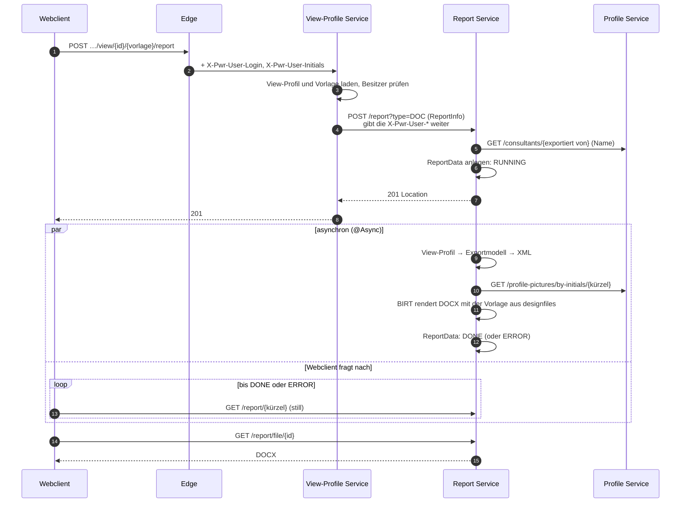
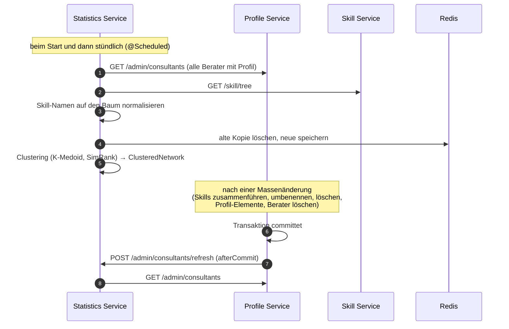
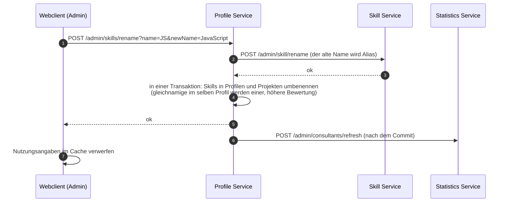
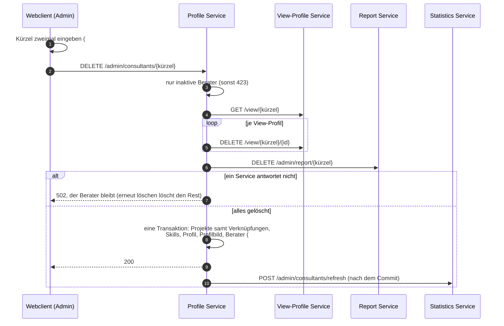
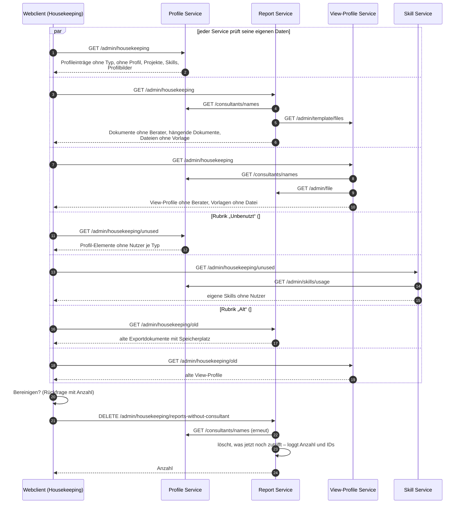

# 6. Laufzeitsicht

Die Diagramme zeigen die wichtigen Abläufe über die Services. Pfade sind so angegeben, wie der Service sie sieht. Von außen haben sie noch `/api/pwr-<service>` davor; der Ingress entfernt `/api`, die Edge `/pwr-<service>`.

## 6.1 Anmeldung und ein Aufruf

- Danach führt die Startseite (`/start`, #263) Admins in die Beraterverwaltung und alle anderen gleich ins eigene Profil (#135). Ohne eigenes Profil oder Kürzel zeigt sie eine Meldung.
- Läuft das Token ab, erneuert MSAL es still (`acquireTokenSilent`). Scheitert das, meldet der Webclient einmal automatisch neu an (#129).
- Profilbilder und Vorschauen lädt der Webclient mit Token als Blob und zeigt sie über eine Blob-URL. Ein `src` oder `iframe` direkt auf die API scheitert an der Edge, weil es kein Token mitschickt (#65, #67).

## 6.2 Einen Skill ins Profil eintragen

Ein Skill in einem Projekt ist derselbe Datensatz wie der Skill im Profil. Fehlt er im Profil, legt `ProfileEntryService.handleProjectSkill` ihn dort an.

## 6.3 View-Profil anlegen

*Aktualisieren* (`POST /view/update/{kürzel}/{alteId}`) baut eine neue Momentaufnahme aus dem aktuellen Profil. Die Einstellungen der alten übernimmt es; umbenannte Elemente findet es über `GET /admin/name-entities/former-names` und den Skill-Baum (#230).

## 6.4 Dokument exportieren (DOCX)

Die **Vorschau** nimmt denselben Weg: `GET …/view/{id}/{vorlage}/preview` → `POST /report/preview`. BIRT rendert dabei PDF im Speicher und speichert nichts. Nach 10 Sekunden bricht das Rendern ab (#155). Kann die Vorlage mit diesen Daten nicht rendern, kommt `422` mit dem Grund als Text.

## 6.5 Statistik aktuell halten

Scheitert das Laden, bleibt die alte Kopie. Ist der Skill Service nicht erreichbar, nimmt der Statistics Service den zuletzt bekannten Baum (#208, #218). Ein Fehler beim Anstoßen nach dem Commit wird nur geloggt; der nächste stündliche Lauf holt das nach.

## 6.6 Einen Skill in allen Profilen umbenennen (Admin)

Zusammenführen (#205) und Löschen (#229) gehen genauso: erst der Skill-Baum, dann die Profile, danach die Statistik.

## 6.7 Berater löschen (Admin)

Die Reihenfolge geht von außen nach innen. Ein Abbruch lässt den Berater stehen, und das Löschen lässt sich wiederholen. Was trotzdem übrig bleibt, findet das Housekeeping ([6.8](#68-housekeeping-admin)). Dokumente, die der Berater für andere exportiert hat, bleiben, ebenso die Profil-Elemente und Skills des Baums.

## 6.8 Housekeeping (Admin)

Antwortet ein benötigter Service nicht oder liefert er keinen einzigen Berater, meldet die Prüfung einen Fehler statt Treffern, und sie lässt sich nicht bereinigen (`503`). Eine leere Liste darf nie alle Daten zu Datenleichen machen.
