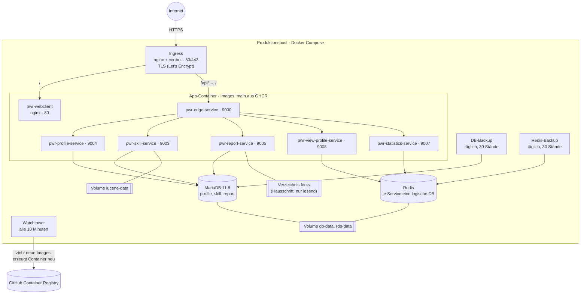
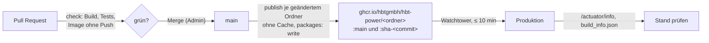
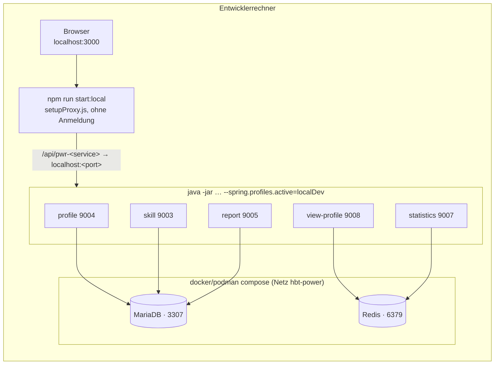

# 7. Verteilungssicht

## 7.1 Produktionsumgebung

Die Produktion läuft auf **einem Host** mit Docker Compose. Ihre Konfiguration (Compose-Datei, Ingress-Konfiguration, Hinweise zu den Schriften) liegt im eigenen, öffentlichen Repository [`HBTGmbH/pwr-compose-deploy`](https://github.com/HBTGmbH/pwr-compose-deploy). Dort ändert man sie per PR; auf dem Host wird das Repository dann aktualisiert. Werte wie Hosts, Passwörter und die IDs der Anmeldung stehen nur in Umgebungsvariablen des Hosts, nirgends im Repository.

| Knoten | Zweck | Hinweise |
|---|---|---|
| **Ingress** (`jonasal/nginx-certbot`) | TLS, `/` → Webclient, `/api/` → Edge (`/api` wird entfernt) | Er löst die Container-Namen laufend über den DNS von Docker auf (`resolver`, `upstream … resolve`). Das ist die Lehre aus dem Ausfall vom 2026-10-20 ([Kapitel 11](11-risiken-und-technische-schulden.md)). |
| **pwr-webclient** | nginx mit den statischen Dateien | `configure_api.sh` setzt beim Start die Service-URLs und die IDs der Anmeldung in `config.js` ein. |
| **pwr-edge-service** | Tokenprüfung, Routing | Der Issuer kommt aus einer Umgebungsvariablen. |
| **Profile, Skill, Report** | Fachliche Services mit MariaDB | Zugangsdaten und `DB_HIBERNATE_DDL_AUTO=update` kommen aus Umgebungsvariablen ([ADR-08](09-architekturentscheidungen.md#adr-08-schema-mit-hibernate-ddl-auto-update-ohne-migrationswerkzeug)). |
| **View-Profile, Statistics** | Fachliche Services mit Redis | Sie nutzen eine Redis-Instanz mit getrennten logischen Datenbanken. |
| **pwr-skill-service** | | Lucene-Index im Volume `lucene-data`, bei jedem Start neu aufgebaut |
| **pwr-report-service** | | Hausschrift aus dem Verzeichnis `fonts` des Deploy-Repositorys, nur lesend unter `/fonts`. Die Dateien sind lizenziert und nicht eingecheckt (#82). |
| **MariaDB** | Daten von Profile, Skill, Report | Version 11.8 (LTS) festgelegt; Upgrades innerhalb der Linie macht `MARIADB_AUTO_UPGRADE`. |
| **DB-Backup** | täglicher Dump der MariaDB, 30 Stände | Auf demselben Host ([Kapitel 11](11-risiken-und-technische-schulden.md), O1). |
| **Redis-Backup** | täglicher Dump des Redis mit den View-Profilen und Vorlagen-Metadaten (`redis-cli --rdb`), 30 Stände (#251) | Eine halbe Stunde nach dem DB-Backup, ebenfalls auf demselben Host. Die Wiederherstellung beschreibt `REDIS-BACKUP.md` im Deploy-Repository. Mit #52 kann es entfallen. |
| **Watchtower** | Spielt neue Images ein | Prüft alle 10 Minuten (`--interval 600`). |

Alle Container liegen im Standardnetz des Compose-Projekts. Die Services erreichen sich über ihre Compose-Namen (`http://pwr-<name>-service:<port>`); das sind die Standardwerte der Properties `pwr-<name>-service-url`. Von außen ist nur der Ingress erreichbar. Die Backend-Services prüfen selbst keine Anmeldung ([Kapitel 8.1](08-querschnittliche-konzepte.md#81-sicherheit)).

## 7.2 Vom Merge in die Produktion

- **Ein Workflow je Ordner** (`.github/workflows/<ordner>.yml`) mit Pfadfilter. Ein PR zeigt nur die Prüfungen der Ordner, die er ändert ([ADR-18](09-architekturentscheidungen.md#adr-18-ci-je-ordner-mit-pfadfiltern-und-getrenntem-publish)).
- **`check`** auf PRs: Lesetoken, Cache erlaubt, `mvn -B package` bzw. `npm ci && npm run build`, Image bauen ohne Push.
- **`publish`** auf `main`: derselbe Build ohne Cache. Der Webclient schreibt zusätzlich `build_info.json`. Danach Push nach GHCR.
- **Merge ist Deployment:** Was vorher in der Umgebung passieren muss, steht im PR unter *Operations / Deployment Notes* und wird vor dem Merge erledigt: SQL-Skript, neue Umgebungsvariable, Redis-Migration.
- **Stand prüfen:** Jeder Service zeigt seinen Commit unter `/actuator/info`, der Webclient in `build_info.json`. Das Info-Symbol der App zeigt alle zusammen (#71).
- **Austausch:** Watchtower erzeugt jeden geänderten Container neu, ohne Rolling Update. Während ein Container neu startet, antwortet er kurz nicht. Beim Webclient sind das etwa 30 bis 60 Sekunden mit 502.
- **Zurück auf einen älteren Stand:** Jedes Image trägt auch `:sha-<commit>`. Ein festgelegtes Verfahren dafür gibt es noch nicht ([Kapitel 11](11-risiken-und-technische-schulden.md)).

## 7.3 Lokale Entwicklung

- **Ohne Edge:** Der Webclient spricht die Services direkt an, und die Identitäts-Header fehlen. Lokal ist man als Admin angemeldet.
- **Testdaten:** `./mvnw sql:execute` in Profile und Skill Service, die Vorlage über `./mvnw exec:exec` im Report Service.
- **Ausführliche Anleitung:** [`README.md`](../../README.md).

## 7.4 Zuordnung der Bausteine

| Baustein | Artefakt | Image (Basis) | Laufzeit |
|---|---|---|---|
| pwr-webclient | `build/` (CRA) | `nginx:alpine` | Container `pwr-webclient` |
| pwr-edge-service | `target/*.jar` | `azul/zulu-openjdk-alpine:13-jre` | Container, Port 9000 |
| pwr-profile-service | `target/*.jar` | `azul/zulu-openjdk-alpine:13-jre` | Container, Port 9004 |
| pwr-skill-service | `target/*.jar` | `azul/zulu-openjdk-alpine:13-jre` | Container, Port 9003, Volume `/lucene-data` |
| pwr-report-service | `target/*.jar` | `azul/zulu-openjdk-alpine:13-jre` mit fontconfig, DejaVu, Noto Sans (Ersatzschrift) | Container, Port 9005, `/fonts` nur lesend |
| pwr-view-profile-service | `target/*.jar` | `azul/zulu-openjdk-alpine:13-jre` | Container, Port 9008 |
| pwr-statistics-service | `target/*.jar` | `azul/zulu-openjdk-alpine:13-jre` | Container, Port 9007 |
