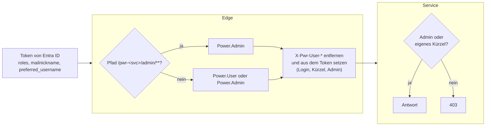
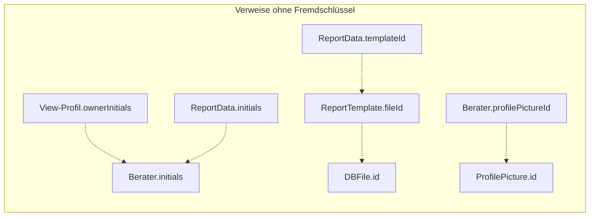

# 8. Querschnittliche Konzepte

Viele Regeln dieses Kapitels stehen ausführlicher in [`AGENTS.md`](../../AGENTS.md); dort sind sie verbindlich. Dieses Kapitel ordnet sie ein.

## 8.1 Sicherheit

- **Anmeldung:** Der Webclient meldet über MSAL (OIDC, Redirect) an Entra ID an. Jeder Aufruf trägt das Access-Token als `Authorization: Bearer` (`PowerHttpClient`).
- **Nur die Edge prüft.** Sie validiert das JWT über den Issuer. Die Rollen kommen aus dem Claim `roles` ohne Präfix.
  - Vorher weist sie jeden nicht normalisierten Pfad mit `400` ab (`NormalizedPathFilter`, #260): Segmente `.` und `..`, `//`, `;`, kodierte `/`, `\` oder `%` und unnötig kodierte Zeichen wie `%2e`. Die Services normalisieren den Pfad selbst; sonst könnte ein Pfad, den die Edge nicht als `/admin` erkennt, beim Service auf einem Admin-Endpunkt landen.
  - Erste Regel: `/pwr-<service>/admin/**` verlangt `Power.Admin`.
  - Danach: alles andere verlangt `Power.User` oder `Power.Admin`.
  - Die Backend-Services haben keine eigene Anmeldung. Sie sind nur im Container-Netz erreichbar. Ob sie Spring Security nutzen sollen, klärt #256.
- **Admin-Funktionen liegen unter `/admin/**`** des jeweiligen Service (#178, #203, #218). Wer einen Endpunkt anlegt oder verschiebt, prüft ihn gegen die Regeln der Edge (Definition of Done). Als zweite Schicht weist jeder Service mit Admin-Endpunkten `/admin` selbst ab, wenn `X-Pwr-User-Admin` `false` ist (`AdminAccessInterceptor`, #260). Er richtet sich nach dem Mapping, das Spring MVC gewählt hat, nicht nach dem Text des Pfads.
- **Wer angemeldet ist**, erfahren die Services nur aus den Headern `X-Pwr-User-Login`, `X-Pwr-User-Initials` und `X-Pwr-User-Admin`. Die Edge setzt sie aus dem geprüften Token, nachdem sie gleichnamige Header des Clients entfernt hat; `X-Pwr-User-Admin` setzt sie auf jede Anfrage (#255).
  - Ein Akteur (Ersteller, Exporteur, Bestätiger) kommt nie aus Body, Pfad oder Query.
  - Ruft ein Service einen anderen im Auftrag des Benutzers, gibt er die Header weiter (Export, #214).
  - Kürzel im Pfad sagen nur, um welches Profil es geht.
- **Nur eigene Daten** (#255): Ein `Power.User` liest und ändert nur die Daten zu seinem Kürzel, ein `Power.Admin` alle. Profile, Report, View-Profile und Statistics Service prüfen das selbst (`security/ConsultantAccess`):
  - Ein Interceptor vergleicht die Pfadvariable `{initials}` jedes Endpunkts mit `X-Pwr-User-Initials`, ohne Groß-/Kleinschreibung.
  - Was über eine ID geladen wird (Dokument, Profilbild, View-Profil), prüft der Endpunkt am Besitzer.
  - Dokumente entstehen nur über den View-Profile Service (#262): Er lädt das View-Profil über seine ID und prüft den Besitzer. `POST /report` und `/report/preview` des Report Service weisen jede Anfrage über die Edge ab, auch eines Admins, und ebenso ein View-Profil, dessen Besitzer nicht zu den Kürzeln im Body passt.
  - Ein ganzes Profil wird nur gelesen (`GET /profiles/{initials}`), nie aus einem Body ersetzt (#261).
  - Eine Anfrage ohne `X-Pwr-User-Admin` kam nicht über die Edge (Aufruf eines anderen Service, lokal) und darf alles.
  - Eine ID im Body muss zum Profil im Pfad gehören, auch für Admins.
  - Für alle offen bleiben nach Entscheidung: Beratersuche, Namensliste, Cluster-Info und Angaben ohne Personenbezug. Personenbezogenes über andere, das nur der Admin-Bereich braucht, liegt unter `/admin`.
  - Der Webclient öffnet einem Benutzer kein fremdes Profil (`OIDCService.mayOpenProfile`).
- **Binärdaten** (Profilbilder, Vorschauen) lädt der Webclient mit Token als Blob. Profilbilder dürfen privat lange gecacht werden (`Cache-Control: private, max-age=365d, immutable`, #67).
- **Datensparsamkeit:** `GET /consultants/names` gibt allen Benutzern nur Kürzel, Kurz- und vollen Namen (#216).
- **Lokal** gibt es keine Edge und keine Anmeldung: Man ist Admin, die Header fehlen (z. B. bleibt „Exportiert von“ leer).
- **Lieferkette:** Actions sind nach einer festen Regel gepinnt und geprüft (actionlint, zizmor, #8). Der `publish`-Job nutzt keinen Cache.

## 8.2 Persistenz

| Service | Speicher | Schema / Modell |
|---|---|---|
| Profile, Skill, Report | MariaDB, eine Datenbank je Service | JPA/Hibernate. Das Schema legt Hibernate an (`ddl-auto: update`, auch in der Produktion seit #27). |
| View-Profile, Statistics | Redis, eine logische Datenbank je Service | Spring Data Redis, ein Objekt als Hash mit einem Eintrag je Feld |
| Skill | zusätzlich Lucene-Index im Dateisystem | Hibernate Search, bei jedem Start neu aufgebaut |

- **Kein Migrationswerkzeug:** Hibernate fügt Tabellen und Spalten hinzu. Umbenennen, Löschen, Typänderungen und Datenmigration brauchen ein SQL-Skript im Ordner des Service (z. B. `pwr-profile-service/fix-id-columns.sql`). Das Skript steht im PR unter *Operations / Deployment Notes* und läuft vor dem Merge ([ADR-08](09-architekturentscheidungen.md#adr-08-schema-mit-hibernate-ddl-auto-update-ohne-migrationswerkzeug)).
- **Redis-Kompatibilität:** Spring Data Redis liest nur die Felder des Modells und schreibt beim Speichern den ganzen Hash neu.
  - Ein Feld umbenennen oder seinen Typ ändern braucht eine Migration.
  - Ein Feld entfernen braucht keine; der alte Eintrag verschwindet mit dem nächsten Speichern (#179).
  - Ein neues Feld fehlt in alten Daten und braucht einen Standardwert. Im View-Profile Service setzt ihn `ViewProfileRestoreAspect`.
- **Hibernate-Fallen** (Details in `AGENTS.md`):
  - `JOINED`-Vererbung mit Altdaten ohne Zeile eines Eintragstyps (#236): Einträge je Typ laden, nie `from ProfileEntry`.
  - Aus Collections entfernte Elemente bleiben als Zeilen stehen. Nutzung zählt man nur über Joins von `Profile`.
  - Der Hash eines `ProfileEntry` hängt an seinem `NameEntity`.
- **Tests mit H2:** H2 läuft mit `IGNORECASE=TRUE`, damit es sich wie die Kollation der MariaDB verhält. H2 ist aber nachsichtiger: Es akzeptiert ein leeres `in ()`, und Fremdschlüssel prüft es erst beim `flush`. Deshalb wird jede `in`-Liste gegen leer abgesichert, und Lösch-Tests schreiben mit `flush` (#243).

## 8.3 Konsistenz über Services

- Verweise zwischen den Services sind bloße Kürzel und IDs. Es gibt keine verteilte Transaktion.
- **Löschen über Services** geht von außen nach innen, und jeder Schritt lässt sich wiederholen. Ein Beispiel ist das Löschen eines Beraters ([6.7](06-laufzeitsicht.md#67-berater-löschen-admin)). Ein Abbruch lässt den eigentlichen Datensatz stehen; erneutes Löschen löscht den Rest.
- **Housekeeping** ([6.8](06-laufzeitsicht.md#68-housekeeping-admin), #242):
  - Jeder Service meldet die Datenleichen seiner eigenen Daten (`GET /admin/housekeeping`) und bereinigt sie selbst (`DELETE /admin/housekeeping/{check}`).
  - Andere Services fragt er nur nach Daten. Fällt einer aus, gibt es einen Fehler statt Treffern.
  - **Regel:** Wer neue Verweise über Service-Grenzen oder neue nicht transaktionale Löschvorgänge einführt, ergänzt eine Prüfung.
- **Abgeleitete Daten:** Die Statistik hält eine Kopie und lädt sie stündlich und nach Massenänderungen neu ([6.5](06-laufzeitsicht.md#65-statistik-aktuell-halten)). Der Webclient verwirft danach seine zwischengespeicherten Nutzungsangaben.
- **Momentaufnahmen:** View-Profile ändern sich nicht mit dem Profil. *Aktualisieren* übernimmt Änderungen bewusst (#230).

## 8.4 Kommunikation zwischen Services

- REST mit JSON über `RestTemplate`. Die Basis-URL kommt aus `pwr-<name>-service-url`; Standard ist der Compose-Name, im Profil `localDev` `localhost`. Feign ist seit 2023 abgelöst ([ADR-03](09-architekturentscheidungen.md#adr-03-aufrufe-zwischen-services-mit-resttemplate)).
- Die Aufrufe gehen direkt, nicht über die Edge. Sie tragen kein Token, und `/admin`-Pfade sind für sie offen.
- **Fehler sind je Fall behandelt:**

  | Fall | Verhalten |
  |---|---|
  | Berater löschen | Abbrechen mit `502` |
  | Statistik anstoßen | nur loggen |
  | Frühere Namen beim *Aktualisieren* | leer weitermachen |
  | Housekeeping | Fehler statt Treffern |

- **Timeouts** (#249): Jeder Aufruf hat einen Verbindungs-Timeout (2 s) und einen Lese-Timeout (10 s); Aufrufe, die bekanntlich länger dauern, 60 s:
  - die PDF-Vorschau und das Hochladen einer Vorlagen-Datei (View-Profile → Report)
  - das Laden aller Berater (Statistics → Profile)
  - das Neuladen der Statistik (Profile → Statistics)

  Die `RestTemplate`s kommen aus `RestClientConfig` je Service; die Werte sind Properties (`pwr.rest.timeout.connect`, `.read`, `.slow-read`). Ein Timeout ist eine `RestClientException` wie ein nicht erreichbarer Service, es greift das Verhalten aus der Tabelle. Die Edge wartet höchstens 90 s auf eine Antwort (`spring.cloud.gateway.httpclient.response-timeout`).

## 8.5 Namen und Stammdaten

- **Groß-/Kleinschreibung:** Die Kollation der MariaDB ignoriert Groß-/Kleinschreibung und Akzente. Namensvergleiche in Java, die dasselbe entscheiden, nutzen `equalsIgnoreCase` (#207).
- **Skill-Namen** stehen für den Namen im Skill-Baum, auch als Alias oder in anderer Schreibweise (#208).
  - Beim Speichern wird nur die Schreibweise des Baums übernommen; Aliase bleiben, wie getippt.
  - Statistik, View-Profile und Admin-Listen zeigen den Namen des Baums.
- **Profil-Elemente:**
  - Sie werden ohne Leerzeichen an den Enden gespeichert; ein leerer Name wird abgelehnt (#215).
  - Umbenannte und zusammengeführte Elemente behalten ihre früheren Namen. Wer einen früheren Namen tippt, bekommt das Element (#227).
- **Namen von Kollegen:** Der Kurzname (`Kai B.`) berechnet der Profile Service (`ConsultantShortNames`, #216). Der Webclient zeigt ihn über `PwrConsultantName` mit dem vollen Namen im Tooltip.

## 8.6 Lokalisierung und Datum

- **Oberfläche:** nur Deutsch. Texte laufen über `PowerLocalize.get`; die Schlüssel stehen in `src/localization/de-DE.json`. Ein fehlender Schlüssel erscheint als `<schlüssel>_NO_LOCALE`.
- **Skills und Kategorien:** Sie lassen sich übersetzen (ISO 639-2, `LocalizedQualifier`). Die Übersetzung erscheint nur in einem View-Profil mit gewählter Sprache und nur im Dokument (#174). Der Name des Baums bleibt überall der Schlüssel.
- **Datum ohne Uhrzeit:** `LocalDate` bleibt im Webclient der String `"YYYY-MM-DD"`. Nur `PwrDatePicker` wandelt in `Date` und zurück; das verhindert Verschiebungen um einen Tag (#24, #26). Zeitstempel sind `Date`.

## 8.7 Fehlerbehandlung, Logging, Überwachung

- **Fehlerformate** je Service (der Webclient versteht alle in `PowerHttpClient.extractApiError`):

  | Service | Format |
  |---|---|
  | Profile | `{timestamp, status, error, message, path}` |
  | View-Profile | `{error: {code, message, …}}` (#221) |
  | Skill | `{id, errorType, message}` |
  | Report | `422` mit Text bei nicht renderbarer Vorlage |
  | Statistics, Edge | Standard von Spring Boot |

- **Webclient:** Jeder Fehler wird als Toast gemeldet und weitergeworfen.
  - `getQuietly`, `getOrNull` und `…Expecting` sind Varianten für erwartete oder stille Fälle.
  - `patchInBackground` zeigt statt der Ladeüberlagerung einen schmalen Balken.
- **Logging:** Standard von Spring Boot, in der Produktion als Container-Log mit Rotation. Bereinigungen und Massenänderungen loggen, was sie getan haben (Anzahl und IDs).
- **Überwachung:** Jeder Service veröffentlicht nur `health` und `info` (`/actuator/info` mit `git.commit`, `git-commit-id-plugin`). Ein Monitoring außerhalb davon gibt es im Repository nicht.

## 8.8 Bedienoberfläche

- **Navigation:** Beide Bereiche haben ein Menü hinter dem Burger-Symbol (#212). Was ausgewählt ist, steht in der URL (ID und Slug, #182), sodass Neuladen und Zurück funktionieren.
- **Ungespeicherte Änderungen** in einem Projekt halten jede Navigation an und fragen nach (#44, #62).
- **Komponenten:** gemeinsame Bausteine aus `modules/general`:
  - `PwrButton` und `PwrIconButton` (Symbol rechts, mit Tooltip);
  - `PwrFormActions` und `PwrConfirmActions`;
  - `PwrListTable`, `PwrFormSection` und `PwrSpacer` (8-px-Raster);
  - `PwrDatePicker`, `PwrConsultantName`, `PwrProfilePicture`.
- **Löschen:** Es fragt immer nach (`makeDeferrable`). Im Admin-Bereich muss man den Namen zweimal eingeben (#181).
- **Farben und Kontrast** (#201): Fehler und zerstörende Aktionen rot, Warnungen dunkelorange, HBT-Orange nur als Akzent; Text mit mindestens 4,5:1. Farben kommen nur aus dem Theme (`PowerTheme.ts`).
- **Mobil:** Unter 992 px gilt Master-Detail (#49).
- **Caching:**
  - Statische Dateien tragen einen Hash im Namen und sind `immutable`, alles andere ist `no-cache` (#9, #10).
  - Wer einen alten Stand im offenen Tab hat, merkt es heute erst beim Neuladen (#247).

## 8.9 Build, Stand und Tests

- **Build:** Jeder Ordner baut für sich: `./mvnw package` (JDK 13) bzw. `npm run build` (Node 20).
- **Stand:** Ein Stand ist ein Commit, keine Versionsnummer (#77).
- **Tests:**

  | Service | Testtechnik |
  |---|---|
  | Profile, Skill | H2, JUnit 4, MockMvc |
  | Report | H2, JUnit 5; BIRT-Rendering mit Zeitlimit |
  | View-Profile | eingebettetes Redis, JUnit 4 |
  | Statistics | Mockito, JUnit 5 |
  | Edge | `WebTestClient` mit JWT-Mock, JUnit 5 |
  | Webclient | keine Tests |

  Aufrufe anderer Services werden mit `@MockBean` oder `MockRestServiceServer` ersetzt.
- **Arbeitsweise** ([`AGENTS.md`](../../AGENTS.md)):
  - Definition of Ready und Definition of Done; der Webclient wird lokal durchgeklickt.
  - Kleine Korrekturen gehen im laufenden Branch mit eigenem Commit.
