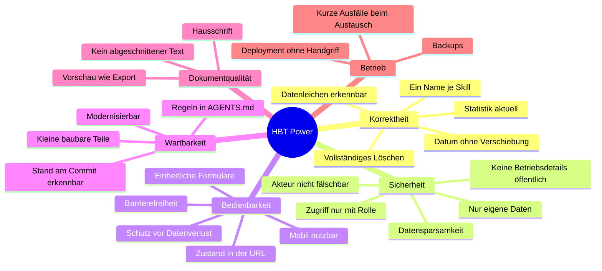

# 10. Qualitätsanforderungen

Die wichtigsten Qualitätsziele stehen in [Kapitel 1.2](01-einfuehrung-und-ziele.md#12-qualitätsziele). Dieses Kapitel ordnet sie in einen Qualitätsbaum und macht sie mit Szenarien prüfbar.

## 10.1 Qualitätsbaum

## 10.2 Qualitätsszenarien

| Nr. | Qualität | Szenario | Erwartete Reaktion | Umgesetzt durch |
|---|---|---|---|---|
| Q1 | Korrektheit | Ein Berater trägt `.net` als Skill ein. | Gespeichert wird `.NET` wie im Skill-Baum. Statistik und Export zählen ihn zusammen mit allen anderen `.NET`. | #207, #208, [ADR-13](09-architekturentscheidungen.md#adr-13-skill-namen-aliase-normalisierung-auf-den-baum-groß-kleinschreibung) |
| Q2 | Korrektheit | Ein Berater wählt in einer Zeitzone östlich von UTC den 1. März als Projektbeginn. | Gespeichert und angezeigt wird der 1. März, nicht der 28. Februar. | #24, #26, [ADR-16](09-architekturentscheidungen.md#adr-16-localdate-als-string-im-webclient) |
| Q3 | Korrektheit | Ein Admin löscht einen inaktiven Berater. | Danach gibt es in keinem Service mehr Daten zu ihm (Profil, Bild, View-Profile, Dokumente). Die Statistik kennt ihn nach dem Commit nicht mehr. | #240, #243, [6.7](06-laufzeitsicht.md#67-berater-löschen-admin) |
| Q4 | Korrektheit | Beim Löschen eines Beraters antwortet der Report Service nicht. | Der Berater bleibt, die Meldung nennt den Fehler (`502`). Erneutes Löschen löscht den Rest. Was liegen blieb, zeigt das Housekeeping. | #240, #242 |
| Q5 | Korrektheit | Ein Admin führt zwei Skills zusammen. | Alle Profile tragen den Zielskill, die Statistik zeigt ihn nach dem Commit, Nutzungsangaben im Webclient werden neu geladen. | #205, [6.6](06-laufzeitsicht.md#66-einen-skill-in-allen-profilen-umbenennen-admin) |
| Q6 | Sicherheit | Ein `Power.User` ruft einen Endpunkt unter `/pwr-<service>/admin/**` direkt auf, auch anders geschrieben (`x/../admin`, `%61dmin`, `admin;x`). | Die Edge antwortet `403` bzw. `400`; käme die Anfrage am Filter vorbei, antwortet der Service selbst `403`. | #178, #203, #218, #260, `SecurityConfigTest`, `SkillAdminAccessITest` |
| Q7 | Sicherheit | Ein Client schickt einen eigenen Header `X-Pwr-User-Login`. | Die Edge verwirft ihn und setzt den Wert aus dem Token; „Exportiert von“ zeigt den echten Benutzer. | #214, `AccountHeadersFilterTest` |
| Q8 | Sicherheit | Jemand ruft ein Profilbild ohne Token ab. | `401`; der Webclient lädt Bilder nur mit Token. | #67 |
| Q8a | Sicherheit | Ein `Power.User` fragt Profil, Dokumente, View-Profile oder Statistik eines anderen Beraters ab, über das Kürzel im Pfad oder eine ID. | `403`; ein Admin bekommt die Daten. Der Webclient öffnet das fremde Profil gar nicht erst und zeigt eine Meldung. | #255, `ConsultantAccessITest` u. a. |
| Q9 | Bedienbarkeit | Ein Berater hat ein Projekt geändert und klickt im Menü auf einen anderen Bereich. | Ein Dialog fragt, ob die Änderungen verworfen werden sollen. | #44, #62 |
| Q10 | Bedienbarkeit | Ein Admin lädt die Seite eines ausgewählten Skills neu oder schickt den Link weiter. | Dieselbe Auswahl erscheint wieder (ID und Slug in der URL). | #182, #212 |
| Q11 | Barrierefreiheit | Text, Warnungen, Fehler und Symbole auf dem Theme-Hintergrund | Text mit mindestens 4,5:1, bedeutungstragende Grafik mit mindestens 3:1 | #201 |
| Q12 | Schutz vor Fehlbedienung | Ein Admin will ein Profil-Element löschen, das 40 Profile benutzen. | Der Dialog nennt die Folgen und gibt `Löschen` erst frei, wenn der Name zweimal eingegeben ist. | #181, [ADR-22](09-architekturentscheidungen.md#adr-22-löschen-in-der-oberfläche-absichern) |
| Q13 | Leistung | Ein Berater öffnet die PDF-Vorschau. | In der Regel unter einer Sekunde. Bleibt BIRT hängen, bricht das Rendern nach 10 Sekunden mit einer Meldung ab. | #155 |
| Q14 | Leistung | Ein Berater blendet in einem View-Profil Einträge ein und aus. | Die Änderung erscheint ohne Ladeüberlagerung; nur ein schmaler Balken an der App-Bar zeigt laufende Anfragen. Schnelle Klicks hintereinander enden beim letzten. | #149, #320, `saveInOrder` |
| Q15 | Dokumentqualität | Ein Export in der Produktion | Text in Simplon Norm, eingebettet; ohne die Schrift Noto Sans im selben Gewicht. | #81, #82 |
| Q16 | Wartbarkeit | Eine Änderung nur am Skill Service | Der PR baut und testet nur den Skill Service; nach dem Merge wird nur sein Image neu gebaut und ausgetauscht. | #6, [ADR-18](09-architekturentscheidungen.md#adr-18-ci-je-ordner-mit-pfadfiltern-und-getrenntem-publish) |
| Q17 | Wartbarkeit | Jemand will wissen, welcher Stand in der Produktion läuft. | Das Info-Symbol zeigt den Commit jedes Teils. | #71, #77 |
| Q18 | Betrieb | Ein Merge nach `main` | Spätestens etwa 10 Minuten nach dem Build läuft der neue Stand, ohne Handgriff. Der Austausch eines Containers dauert unter einer Minute. | [ADR-07](09-architekturentscheidungen.md#adr-07-betrieb-mit-docker-compose-auf-einem-host-und-watchtower) |
| Q19 | Betrieb | Nach einem Deployment hat ein Berater Power noch offen. | Spätestens 5 Minuten nach dem Deployment, oder sobald er den Tab wieder öffnet, erscheint der Hinweis „Eine neue Version von Power ist verfügbar.“ mit **Neu laden**. | #9, #247 |
