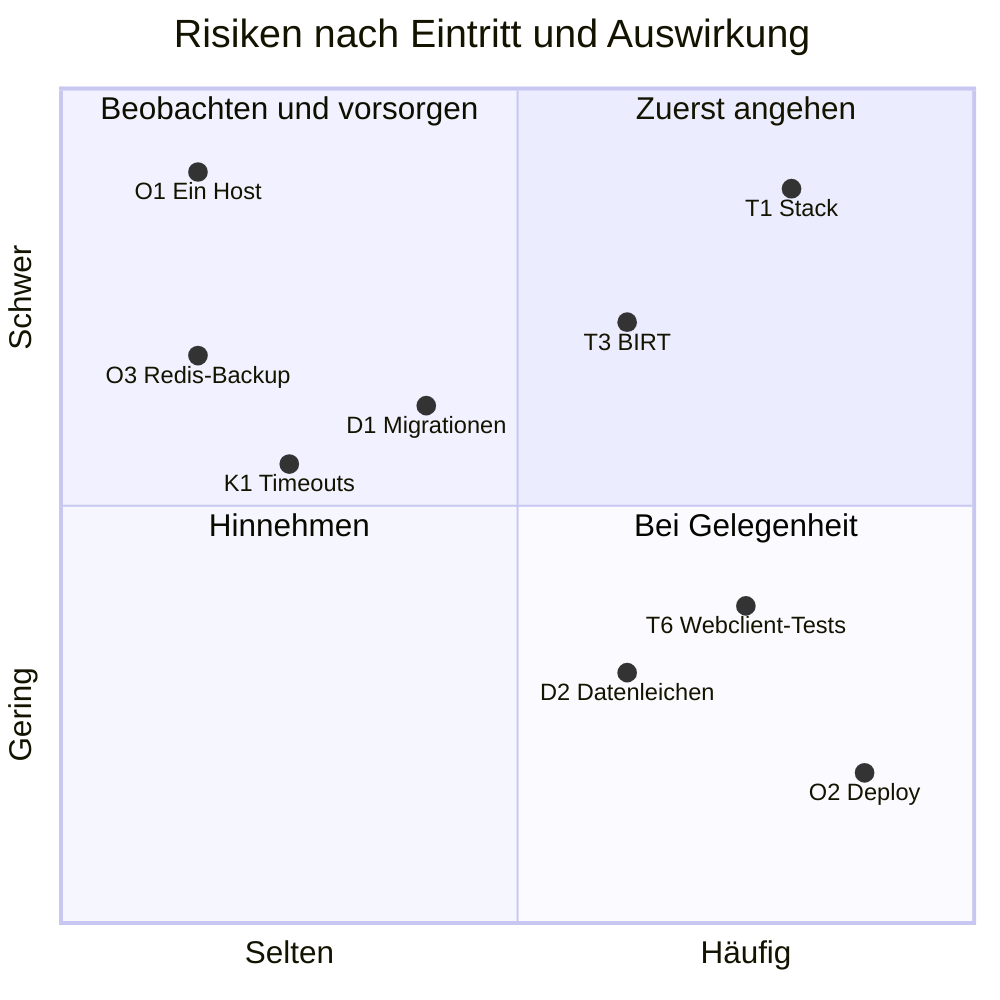

# 11. Risiken und technische Schulden

Bewertung: **hoch** heißt, das Risiko kann Daten, Sicherheit oder Verfügbarkeit treffen oder blockiert die Weiterentwicklung; **mittel** heißt, es kostet Aufwand oder führt zu Fehlern, die man bemerkt; **niedrig** ist lästig.

## 11.1 Technik und Stack

| Nr. | Risiko / Schuld | Bewertung | Auswirkung | Maßnahme |
|---|---|---|---|---|
| T1 | **Veralteter Stack:** Spring Boot 2.2 (Profile, Skill, Report, View-Profile) und 2.7 (Edge, Statistics), JDK 13 (keine LTS-Version), alte Lombok-Versionen | hoch | Keine Sicherheitskorrekturen mehr. Lombok verhindert ein neueres JDK. Jede neue Bibliothek muss zu diesem Stand passen. | Erst zusammenlegen (#50), dann Java und Spring Boot aktualisieren (#51) |
| T2 | **Webclient:** Material-UI v4, react-scripts 5 (Create React App), react-router 5, axios 0.19, Redux ohne Toolkit, `@material-ui/pickers` mit moment | mittel | Material-UI v4 bremst React-Upgrades. Node 20 ist festgelegt, npm 11 scheitert an den Abhängigkeiten. | #53; danach den Build ersetzen (z. B. Vite) |
| T3 | **BIRT 4.3.1** mit iText 2.1.7 und vielen alten transitiven Abhängigkeiten | hoch | Sicherheitsrisiko, bremst Java-Upgrades. Vorlagen lassen sich nur im BIRT Designer bearbeiten. DOCX ohne Formatvorlagen. | #64 (Alternativen untersuchen) |
| T6 | **Keine Tests im Webclient**; in Profile, Skill und View-Profile überwiegt noch JUnit 4 | mittel | Fehler in der Oberfläche fallen erst beim Durchklicken auf. | Tests für Reducer und Clients; JUnit 5 mit dem Upgrade (#51) |
| T7 | **H2 statt MariaDB in Tests** | mittel | H2 akzeptiert ein leeres `in ()`, prüft Fremdschlüssel erst beim `flush` und vergleicht Akzente anders. Fehler mit Altdaten zeigten sich erst in der Produktion (#236, #243). | Regeln in `AGENTS.md`; mittelfristig Tests gegen MariaDB (z. B. Testcontainers) |
| T8 | **Abhängigkeiten** von Maven und npm werden nicht überwacht (Dependabot nur für Actions) | mittel | Bekannte Lücken bleiben unbemerkt. | Nach dem Upgrade Dependabot oder Renovate für Maven und npm |
| T9 | **Uneinheitliche Fehlerformate:** Der Skill Service antwortet `{id, errorType, message}`, der Webclient erwartet `error` und `message` | niedrig | Fehlermeldungen des Skill Service sind vermutlich unvollständig („undefined: …“). | Format angleichen oder in `extractApiError` übersetzen |

## 11.2 Daten und Konsistenz

| Nr. | Risiko / Schuld | Bewertung | Auswirkung | Maßnahme |
|---|---|---|---|---|
| D1 | **Keine Schema-Migrationen** ([ADR-08](09-architekturentscheidungen.md#adr-08-schema-mit-hibernate-ddl-auto-update-ohne-migrationswerkzeug)) | mittel | SQL-Skripte laufen von Hand. Alte Spalten bleiben, Umgebungen können auseinanderlaufen. #72 geht noch von `ddl-auto: none` aus. | Migrationswerkzeug mit dem Upgrade (#51) |
| D2 | **Nicht transaktionales Löschen über Services, Verweise ohne Fremdschlüssel** (Berater, Vorlagen und ihre Dateien) | mittel | Datenleichen und Teilzustände | Housekeeping (#242), wiederholbares Löschen (#240); die Zusammenlegung (#50) macht vieles zu echten Fremdschlüsseln |
| D3 | **Altdaten:** Zeilen in `profile_entry` ohne Eintragstyp, Einträge, Projekte und Skills ohne Profil, alte Benachrichtigungen | mittel | Funktionen scheitern an unerwarteten Daten (#236, #243). | Housekeeping bereinigen; Code lädt Einträge je Typ |
| D4 | **Statistikkopie** bis zu einer Stunde alt | niedrig | Einzelne Änderungen erscheinen verzögert in Statistik und „wer benutzt was“. | Neuladen nach Massenänderungen; bei Bedarf auch nach einzelnen |
| D5 | **Redis-Modelle** müssen alte Daten lesbar halten | mittel | Ein umbenanntes Feld verliert seine Daten ohne Migration. | Regel in der Definition of Done; Ablösung von Redis (#52) |
| D6 | **Benachrichtigungen** im Postkorb entstehen seit 2019 kaum noch | niedrig | Toter Code und unklare Funktion | #138 |

## 11.3 Betrieb

| Nr. | Risiko / Schuld | Bewertung | Auswirkung | Maßnahme |
|---|---|---|---|---|
| O1 | **Ein Host** für alles: Anwendung, Datenbanken und Backup | hoch | Fällt der Host aus, ist Power weg. Liegt das Backup auf demselben Host, ist es mit weg. | Backup zusätzlich außerhalb des Hosts ablegen; Wiederherstellung üben |
| O2 | **Merge ist Deployment, ohne Staging und Rolling Update** | mittel | Kurze 502 beim Austausch der Container. Ein fehlerhafter Stand ist sofort live. Am 2026-10-20 gab es 15 Minuten lang 502, weil der Ingress die Container-IPs nur beim Start auflöste; behoben im Deploy-Repository. | Durchklicken vor dem Merge (Definition of Done); Produktion nach jedem Merge prüfen; Hinweis auf neue Version im Webclient (#247) |
| O3 | **Redis nicht im Backup** (View-Profile, Vorlagen-Metadaten) | mittel | Ein Verlust des Volumes nimmt alle View-Profile und die Zuordnung der Vorlagen zu ihren Dateien mit. | Redis-Dump ins Backup aufnehmen; Ablösung von Redis (#52) |
| O4 | **Kein beschriebenes Zurück** auf einen älteren Stand | mittel | Bei einem fehlerhaften Deployment muss improvisiert werden. | Vorgehen mit `:sha-<commit>`-Images beschreiben |
| O5 | **Watchtower** aus einem nicht mehr gepflegten Fork; Ingress- und Redis-Image ohne feste Version | mittel | Unerwartete Updates oder fehlende Korrekturen | Fork wechseln (offener PR im Deploy-Repository); Versionen festlegen |
| O6 | **Keine Pflicht-Checks** in CI | niedrig | Ein Merge mit rotem Check ist möglich. | Prüfen vor dem Merge; ein zusammenfassender Check, der immer meldet |
| O7 | **Kein Monitoring** außer `health` und `info` | mittel | Ausfälle bemerkt erst ein Benutzer. | Einfache Verfügbarkeitsprüfung von außen |

## 11.4 Kommunikation und Sicherheit

| Nr. | Risiko / Schuld | Bewertung | Auswirkung | Maßnahme |
|---|---|---|---|---|
| K1 | **Keine Timeouts** in den `RestTemplate`-Clients | mittel | Hängt ein Service, hängen seine Aufrufer mit, bis hin zu blockierten Threads. | Verbindungs- und Lese-Timeouts setzen |
| K2 | **Die Sicherheit hängt an der Edge und am Netz:** Die Backend-Services prüfen kein Token, sondern glauben den Headern der Edge; eine Anfrage ohne `X-Pwr-User-Admin` gilt als Aufruf eines anderen Service und darf alles (#255). | mittel | Ist ein Service am Ingress vorbei erreichbar, ist er offen. | Nur der Ingress ist von außen erreichbar; neue Endpunkte gegen die Regeln der Edge und die Prüfung je Berater prüfen (Definition of Done); Spring Security oder eigene Tokenprüfung in den Services: #256 |
| K3 | **CORS der Edge** lässt jede Herkunft mit Anmeldedaten zu. | niedrig | Die Anmeldung läuft über das Bearer-Token, nicht über Cookies; die Wirkung ist daher begrenzt. | Auf die eigene Herkunft beschränken |
| K4 | **Öffentliche Repositories:** Die Regel „keine Betriebsdetails“ hängt an Disziplin. | mittel | Einmal veröffentlicht, bleibt es in der Historie. | Regel in `AGENTS.md`, Prüfung im PR |

## 11.5 Organisation

| Nr. | Risiko | Bewertung | Maßnahme |
|---|---|---|---|
| L1 | Wissen steckt in Issues und Köpfen. | mittel | Diese Dokumentation (#246) und `AGENTS.md` im selben PR wie die Änderung pflegen |
